# Car parts art kit (Blender)

Implements the part family from `output/pdf/Car-Parts-and-VFX-Art-Concept.pdf` (pages 02–03) and adds a speed bump look for the road roller. Only the looks change: colliders, rigid bodies, joints, socket ids and save data are the ones the part factory already made.

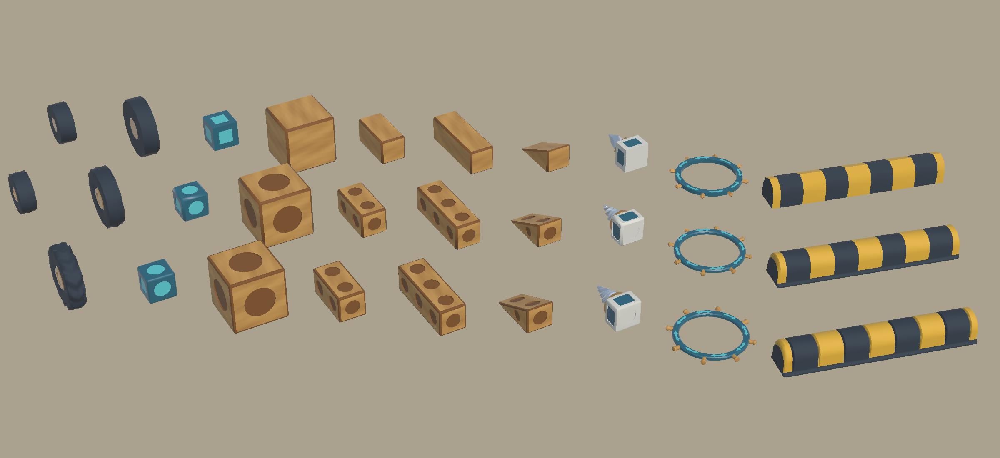

Blender source renders: [all LODs](Images/CarPartsArt-Blender-AllLODs.png), LOD0 close-ups [A](Images/CarPartsArt-Blender-LOD0-A.png) and [B](Images/CarPartsArt-Blender-LOD0-B.png).

## Files

| Path | Purpose |
| --- | --- |
| `Assets/MetaHackthone/Art/CarParts/Source~/BuildCarPartsArt.py` | Builds every mesh in Blender 4.3, headless. `Source~` is ignored by Unity. |
| `Assets/MetaHackthone/Art/CarParts/Source~/CarParts.blend` | Editable source, laid out by part and LOD. |
| `Assets/MetaHackthone/Art/CarParts/Source~/CarPartsManifest.json` | Triangle counts, bounds and material slots per LOD. |
| `Assets/MetaHackthone/Art/CarParts/Models/*.fbx` | One FBX per visual piece, objects `<Piece>_LOD0..2`. |
| `Assets/MetaHackthone/Art/CarParts/Materials`, `Textures` | Nine URP Lit materials and the tileable wood grain. |
| `Assets/MetaHackthone/Art/CarParts/Prefabs` | Visual-only prefabs with a `LODGroup`, for scene dressing and review. |
| `Assets/MetaHackthone/Resources/CarPartArt.asset` | Library read at runtime (`CarPartArtLibrary`). |

Rebuild the meshes, then re-import:

```
"C:\Program Files\Blender Foundation\Blender 4.3\blender.exe" --background --factory-startup --python Assets/MetaHackthone/Art/CarParts/Source~/BuildCarPartsArt.py
```

In Unity: **MetaHackthone > Car Parts Art > Import Blender kit** (and **Capture preview** for `Docs/Images/CarPartsArt-Unity.png`). The importer fails loudly if a mesh arrives mirrored, a LOD is missing or material slots differ between LODs.

## Base size

Meshes are authored in metres at `GeometryScale` 1, in Unity part space (X right, Y up, Z forward), so an FBX dropped in a scene at scale 1 matches a part with `GeometryScale` 1. `u` = `BuildingGeometry.Unit` = 8.728 cm.

| Part | Size at scale 1 | Notes |
| --- | --- | --- |
| Small wheel | radius 0.789u (6.89 cm), width 0.605u | Tyre and hub are separate pieces; tyre spins about X |
| Large wheel | radius 1.158u (10.11 cm), same width | Hub faces are flat with a shallow dimple at ±0.48 width |
| Core | 1u cube | Enamel shell, energy disc inset on all six faces (own material slot) |
| Cube | 2u cube | One large dark dimple per face (four small ones read as a die) |
| Short / long block | 1u × 1u × 2u / 3u | Grain along the long axis; one dark dimple per socket |
| Triangle | 1u × 1u × 2u right prism | Flat slope, dimples at the seven sockets |
| Drill | housing inside the one-cube collider, bit to `SandboxDrill.Tip` | Bit is a separate piece under the spinning transform |
| Speed bump | modules for a roller of diameter 1 | Scaled by the roller's `Diameter`, stretched to its `Width` |

The game scales parts at runtime (`GeometryScale`); the art visual takes the same uniform scale. Typical values: about 0.4 on the workbench (u ≈ 3.5 cm, 35–60 cm from the eyes) and 0.8 on the track (u ≈ 7 cm, 1.5–10 m away).

## LOD

| Piece | LOD0 | LOD1 | LOD2 |
| --- | --- | --- | --- |
| Wheel tyre | 1056 | 432 | 96 |
| Wheel hub | 384 | 192 | 32 |
| Core | 788 | 284 | 108 |
| Cube | 900 | 452 | 44 |
| Short block | 788 | 404 | 44 |
| Long block | 1040 | 516 | 44 |
| Triangle | 544 | 274 | 32 |
| Drill housing | 560 | 368 | 140 |
| Drill bit | 432 | 90 | 24 |
| Speed bump module (mid / end) | 164 / 206 | 56 / 86 | 24 / 24 |
| Turntable handwheel | 2176 | 1088 | 608 |

Triangles. LOD0 has two-segment bevels, round dimples and chevron tread. LOD1 keeps single chamfers, octagonal dimples and a coarser tread. LOD2 is the outline with its dark chamfer (the core and drill keep their colour panels). All three fill the same physical outline.

Switching is by **the angle one building unit subtends at the eye**, which is independent of part scale and display resolution:

| Level | Rule (`CarPartArt.asset`) | Workbench part (u ≈ 3.5 cm) | Track car (u ≈ 7 cm) |
| --- | --- | --- | --- |
| LOD0 | ≥ 1.6° | nearer than about 1.2 m | nearer than about 2.5 m |
| LOD1 | 0.5° – 1.6° | 1.2 – 4 m | 2.5 – 8 m |
| LOD2 | < 0.5° | beyond 4 m | beyond 8 m |

At about 24 pixels per degree (Quest 3), LOD0 ends when a bevel is under one pixel and a tread groove under four; LOD1 ends when a whole unit is about twelve pixels. A 12% hysteresis band stops flicker at a threshold. Tune `Lod0Degrees` / `Lod1Degrees` on the asset.

Assembled parts use `CarPartLod`, which swaps the mesh on **one** renderer, rather than a `LODGroup`. Outlines, ghosts, dissolves, reward previews and the pinch test all walk `AssemblyPart.VisualRenderers`; three LOD renderers per body would draw each of those effects three times. The prefabs and the speed bump are plain scenery and use a standard `LODGroup`, with screen heights derived from the same angular rule for a 96° vertical field of view.

## Seams between joined blocks

Wood blocks carry a second material, `CarArt_WoodEdge`: every chamfer and every dimple (floor and wall) is a darker brown. Two identical blocks joined face to face show a dark double line at the seam, at every LOD.

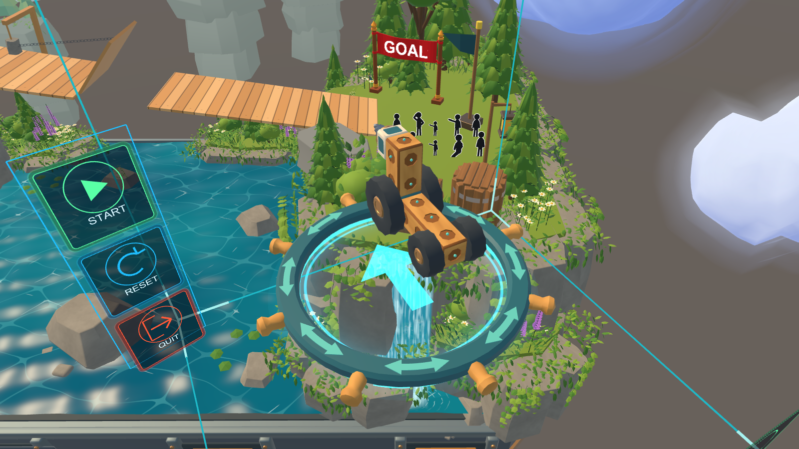

## Turntable handwheel

`DownhillRotationWheel` keeps its trigger grips and grab circle (radius 0.17 m). The flat emblem stays underneath; a solid handwheel (`Handwheel` child, lifted 12 mm) now sits on the grab circle: an enamel rim, eight wooden handles and double-headed arrows inlaid in teal. Wheels saved in scenes gain it when they start.

## Speed bump

`SandboxRoller` keeps its cylinder `MeshCollider` exactly as before and hides its renderer. The gravel heap is replaced by a yellow and dark striped rubber bump (`Speed bump` child): an arch as tall and as wide as the cylinder, a low base flange, an odd number of alternating modules and two blunt yellow ends. Levels baked with gravel are upgraded when they load; rebaking a track writes the bump into the scene. **Car Parts Art > Replace baked gravel with speed bumps (open scenes)** writes the swap into scenes already baked: Levels 3 and 5 (the two levels with a roller) are done and published.

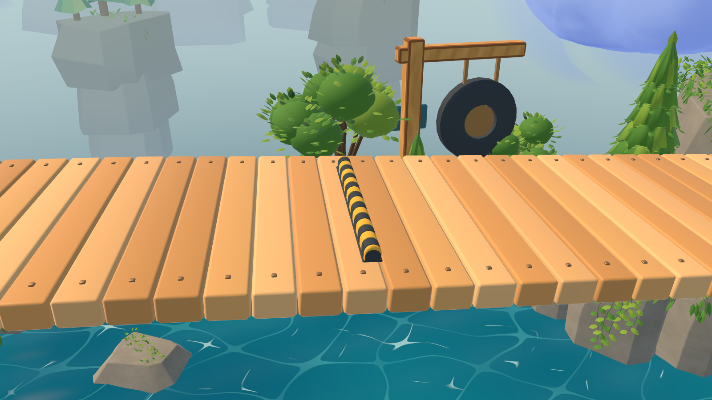 The bump's LOD rule is the angle its height subtends: LOD0 ≥ 2°, LOD1 ≥ 0.7°.

## Level 3 and Level 4 dressing

Levels 3 and 4 share one baked island. Seen from the player's seat it had its tall trees on the near right (the finish) and bare boulders in open water on the near left. Each level now has a group under `Environment/Car campaign scenery` that adds weight on the near-left boulders and the far-right bank, and each uses plants and props of its own:

| | Level 3 – wheelwright | Level 4 – quarry |
| --- | --- | --- |
| Group | `Level 3 counterweight dressing` | `Level 4 counterweight dressing` |
| Trees | round-canopy broadleaf, daisies | pines, ferns |
| Props (Blender, 3 LODs) | `CarArt_Prop_TyreStack`, `CarArt_Prop_WheelSign` | `CarArt_Prop_StoneBlocks`, `CarArt_Prop_OreCart` |
| Waterfall | rock spring (see below) | rock spring (see below) |

Plants are copies of the endpoint islands' plants. Nothing has a collider and nothing enters the road clearance. Saving `Level3.unity` / `Level4.unity` exported them to `Generated/Campaign/Level3.prefab` / `Level4.prefab`. Re-running the scenery authoring commands that rebuild `Car campaign scenery` would remove these groups. The island itself (rock, river, baked trees) is still the same model in both levels.

| | Before | After |
| --- | --- | --- |
| Level 3 | 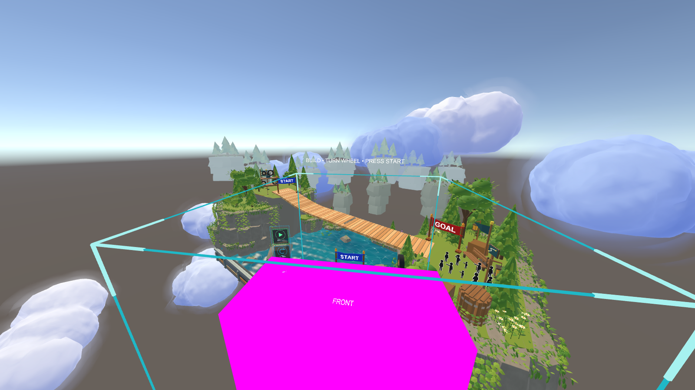 | 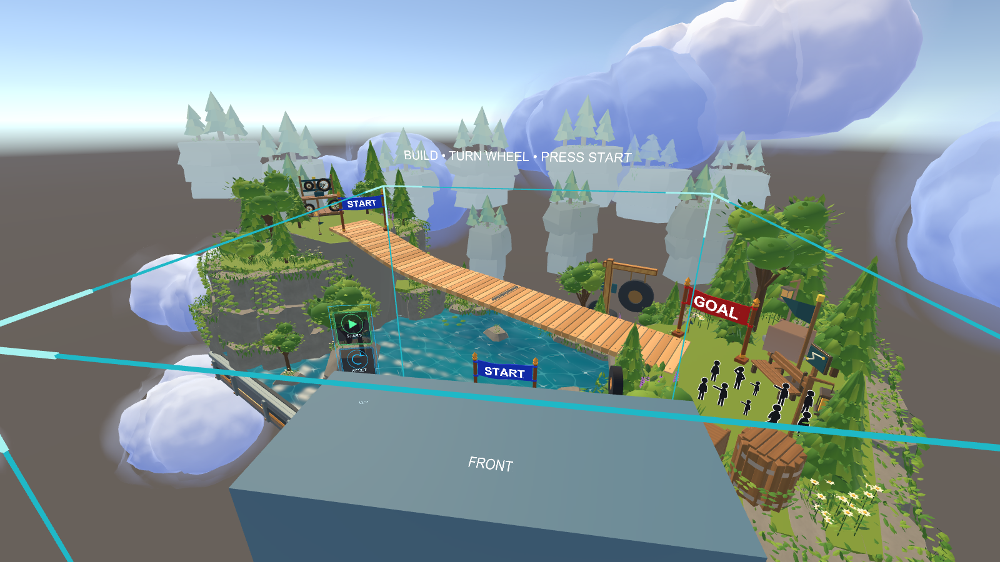 |
| Level 4 | 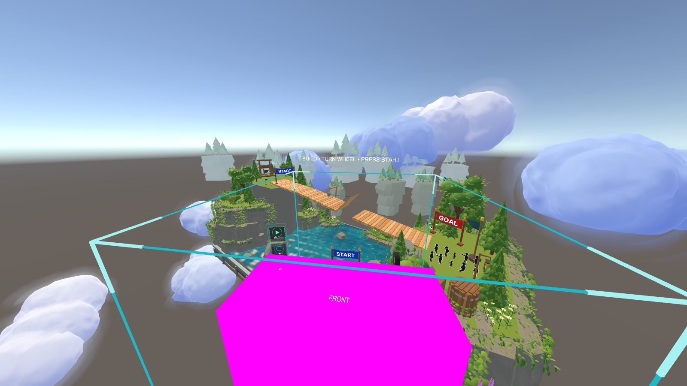 | 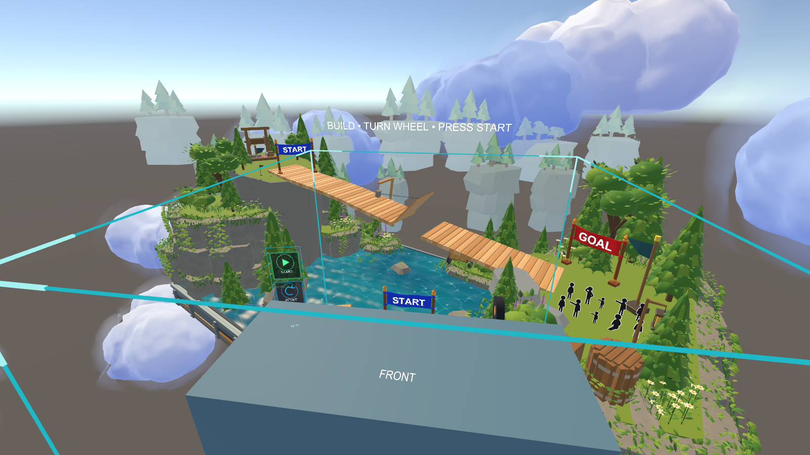 |

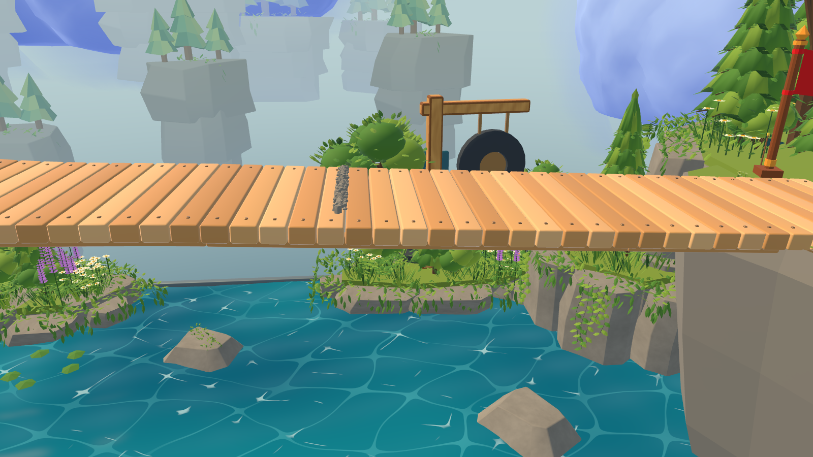
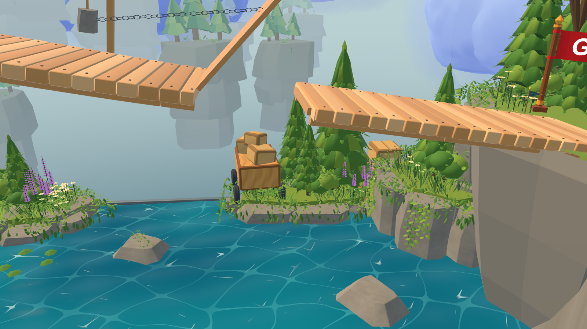

## Far scenery: clouds and horizon islands

All changes are in shaders, so every level gets them and no scene was edited.

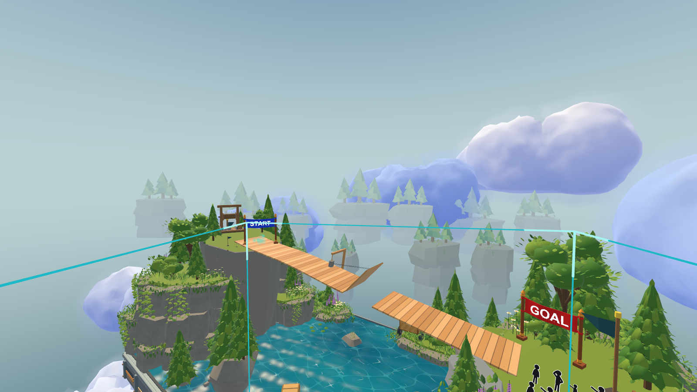

- **Horizon islands** (`CreekHorizon.shader`): a slow float, 0.2 m at about 0.55 rad/s, as a wave across each bank so neighbouring islands are out of step (one sine per vertex, no scripts). Undersides sink into a sky-blue haze and crowns warm slightly, graded per vertex. Still one opaque, textureless, unlit pass.
- **Clouds** (`CreekCloudPuff.hlsl`, `CreekCloudPuff.shader`): the same reach of drift, sway and bob at about twice the speed (a wind swing takes roughly 40 s). Crowns take a little of the sun colour and bellies sink toward the shadow colour.
- **Cost of the ten clouds per level**, counted from the code, not measured on a headset:

| | Before | After |
| --- | --- | --- |
| Draws | 30 | 20 |
| Triangles per cloud mesh | 5,120 | 2,420 |
| Triangles drawn (body and shell, ten clouds) | 153,600 | 48,400 |
| 3D texture reads in the vertex stage, per eye | about 256,000 | about 73,000 |
| Transparent layers over each cloud | 2 | 1 |

  The haze shell is one pass instead of two (`CreekCloudShell.shader`), and the body rebuilds its normal from the broad noise octave alone (four reads per vertex instead of six).
- **Cloud meshes** (`Creek Art > Reduce cloud puff triangles`, `CreekCloudPuffReduction.cs`): CloudPuff A–D are re-sampled from the authored level-4 icosphere onto a frequency-11 geodesic sphere, 2,420 triangles instead of 5,120. Each new vertex sits in the authored sphere's own triangle and takes its positions and vertex colours, so the shape is the same surface sampled more thinly (no reduced vertex is further than 2% of the cloud's width from an authored one). The command regenerates the authored puff first, so it can be run again; change `Frequency` for another density.

## River water highlights

`CreekWater.shader` (`Living river` material, Levels 1–4). The sharp sun lobe broke into pale blocks on the ripples and the glints drew four-pointed stars. Both are replaced by one broad, quiet sheen where the sun reflects and by long soft lines that drift downstream; the lines fade out where they would be thinner than a pixel. The caustic net, shore foam, colours and depth options are unchanged.

| Before | After |
| --- | --- |
| 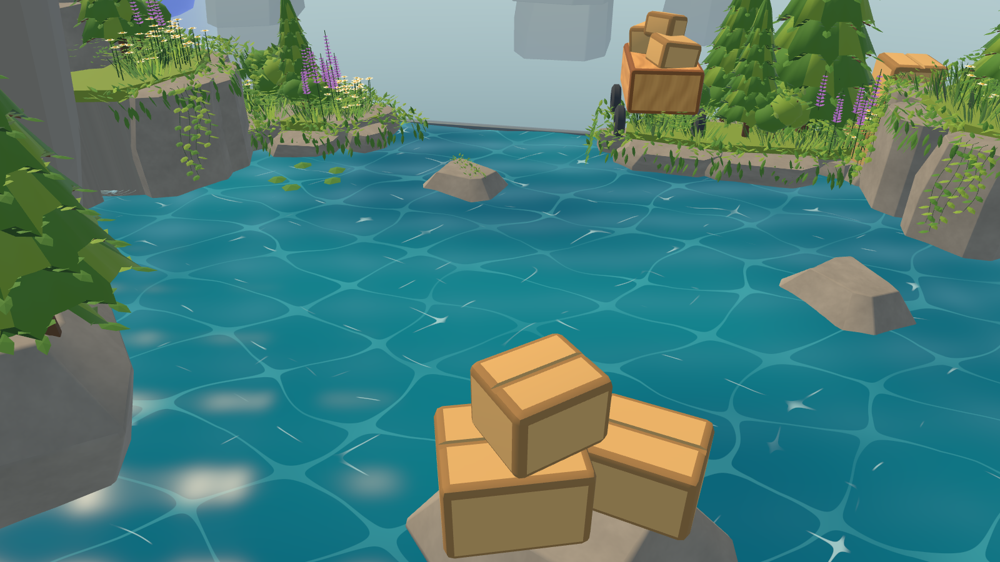 | 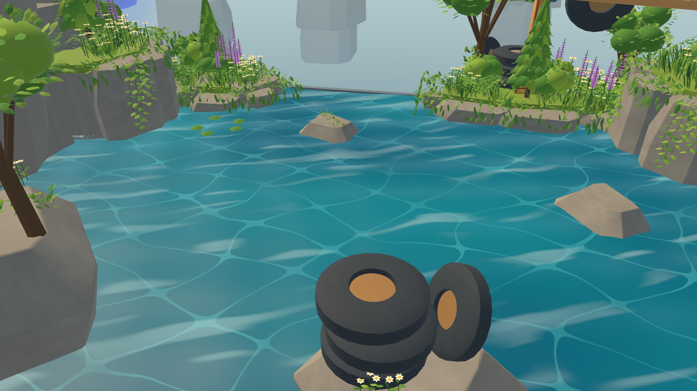 |

## Waterfall spring

The island's near-right waterfall began under a turf lip with nothing feeding it. Built mouths (a wooden flume, a stone culvert) were tried and rejected as ugly, and are removed from the kit. Each level's dressing group now has a `Waterfall spring` child instead, made only from the island's own rock and plants: two `Rock_Stratum` boulders flank the top of the fall so it leaves through a notch in the rock, ferns sit on them, and a short run of the same waterfall material lies between them behind the lip, so the water arrives from the hillside and spills over. No colliders; nothing in the road clearance.

| Before | After |
| --- | --- |
| 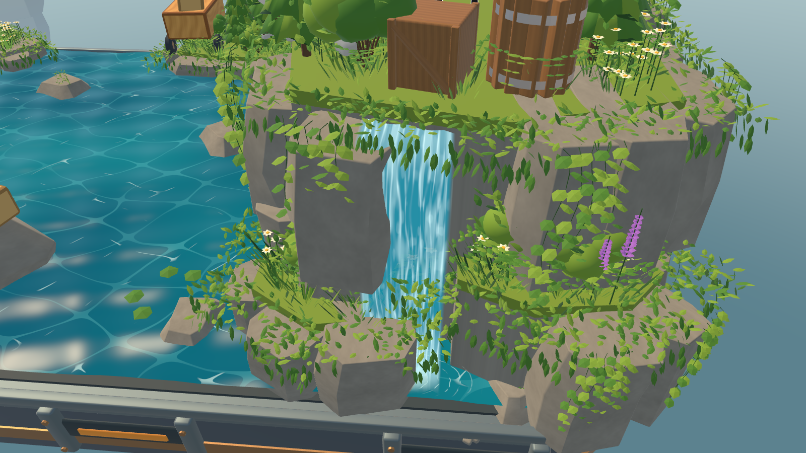 | 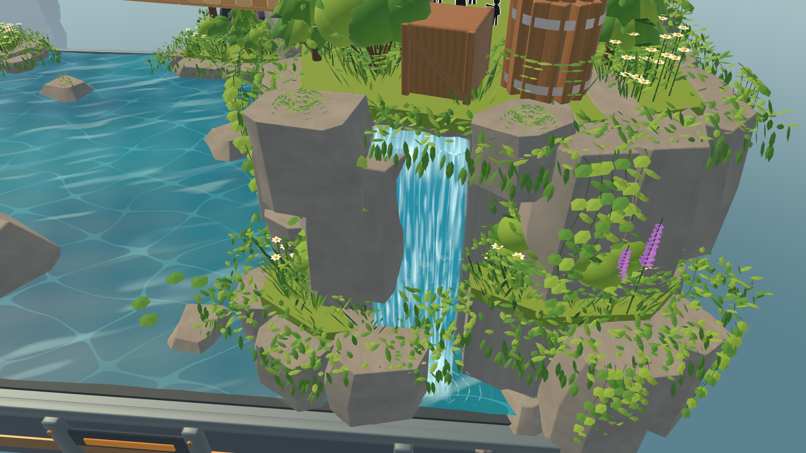 |

## Build boundary frame

`CreekRangeFrame.shader` (the cyan box that shows where parts can be handled). Same meshes, still opaque and textureless. The corners now read as brackets, a little thicker and brighter; the lines between them are thinner and dim with height; a soft band of light climbs the frame about every six seconds; and the corners breathe slightly.

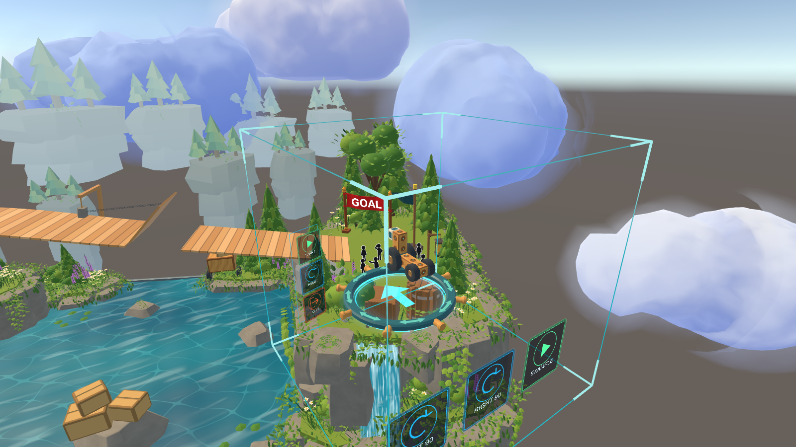

## Playing the intro cinematic in the editor

Pressing Play inside a level scene starts Design Mode, where the intro never runs. Go through the menu instead:

1. **MetaHackthone > Cinematic > Reset First Entry Intro** (only needed if it has already been watched).
2. **MetaHackthone > Play Desktop Game**. The main menu opens in Play mode.
3. Choose **WORKBENCH BUILD**. Level 1 loads and the intro starts by itself.

While standing in an untouched Level 1 reached that way, **MetaHackthone > Cinematic > Play Intro Now** replays it.

## Intro pull

The black-hole lens this pass toned down no longer exists: changeset 269 removed `SandboxSpaceLens` and replaced the pull with a blueprint and tethers. The lens changes made here were dropped in the merge and nothing in this pass touches the intro.

## Editor-only player marker

The magenta block at the workbench in edit-mode screenshots was `Player Start/Player view (editor only)`, a camera-shaped marker that used Unity's built-in Default-Material, which URP draws magenta. It is tagged EditorOnly and hidden at runtime, so it never appeared in the game. `SandboxPlayerStartAuthoring.Ensure` now gives it `Art/SceneLayouts/PlayerViewMarker.mat`; Levels 3 and 4 are fixed, and **Design Mode > Add Player Start Markers to Open Scenes** fixes any other open level.

## Reward and feedback effects

Particle counts, timings and events are unchanged; only shapes, sizes and colours moved.

- `SandboxGlow.shader`: each mote is a soft disc with a short, fat four-point glint instead of a hairline cross. Faint glows (alpha under about 0.3) lose the disc and glint and keep only a smooth falloff, so overlapping ones merge.
- Halo: one steady glow behind the part and six broad fans (eight faint discs each) in place of twelve dotted spokes.
- Reveal sparkles: one in four is a large soft glow, cream cooling to gold.
- Stream: four beads with short tails instead of a dotted line.
- Delivery: two comets (a broad leader and a slimmer follower) with one twist, cooling to teal at the hand.
- Palm reminder: a teal crescent over a faint full circle; the hand outline is a quieter teal.

| Before | After |
| --- | --- |
| 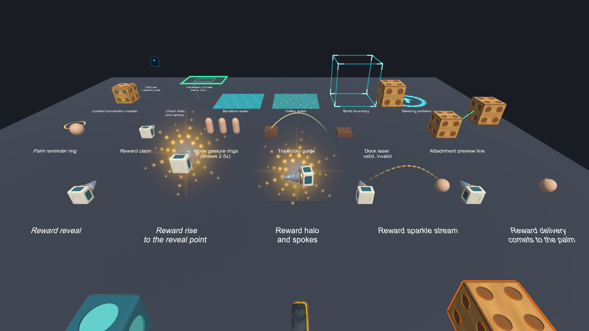 | 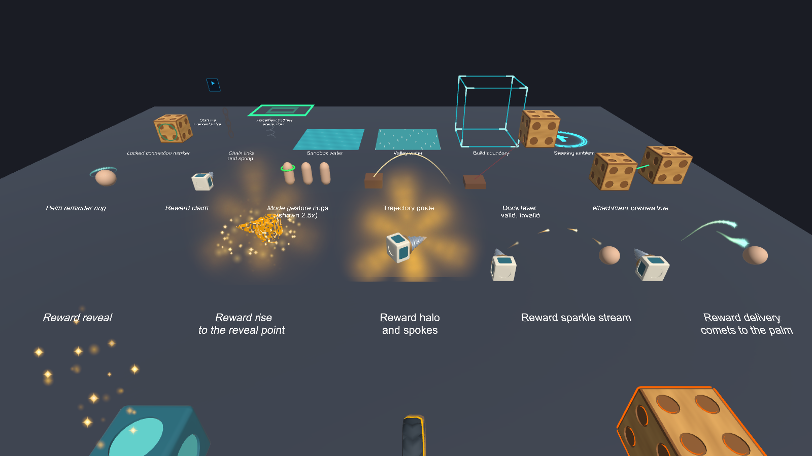 |

## Turning it off

Untick **Enabled** on `Resources/CarPartArt.asset` (or delete the asset): designer parts return to their procedural look, rollers to gravel and the turntable to its flat emblem. The effect restyle, the level dressing groups and the far scenery shaders are separate from the kit.

## Checks

`Assets/MetaHackthone/Tests/EditMode/CarPartArtTests.cs` compares each part built with and without the art (sockets, collider types and sizes, masses), checks every LOD against the collider outline, the LOD distances and the speed bump's extents. `SandboxDrillProfileTests` now measures the rendered drill rather than a single mesh.

Not yet checked on a headset: material response under the level lighting, LOD pop distances in motion, and frame time.
