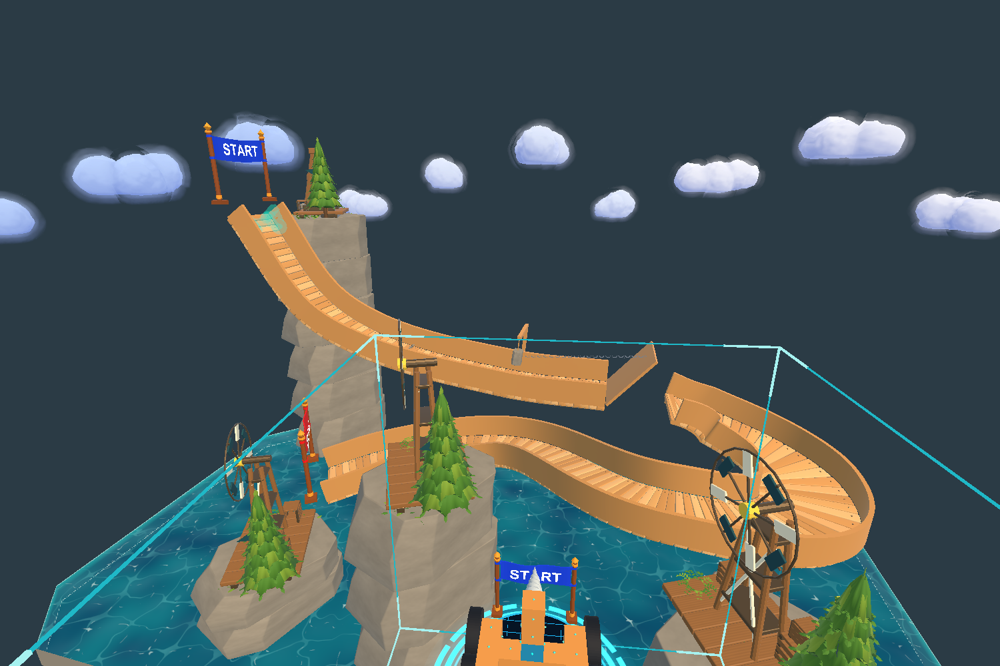
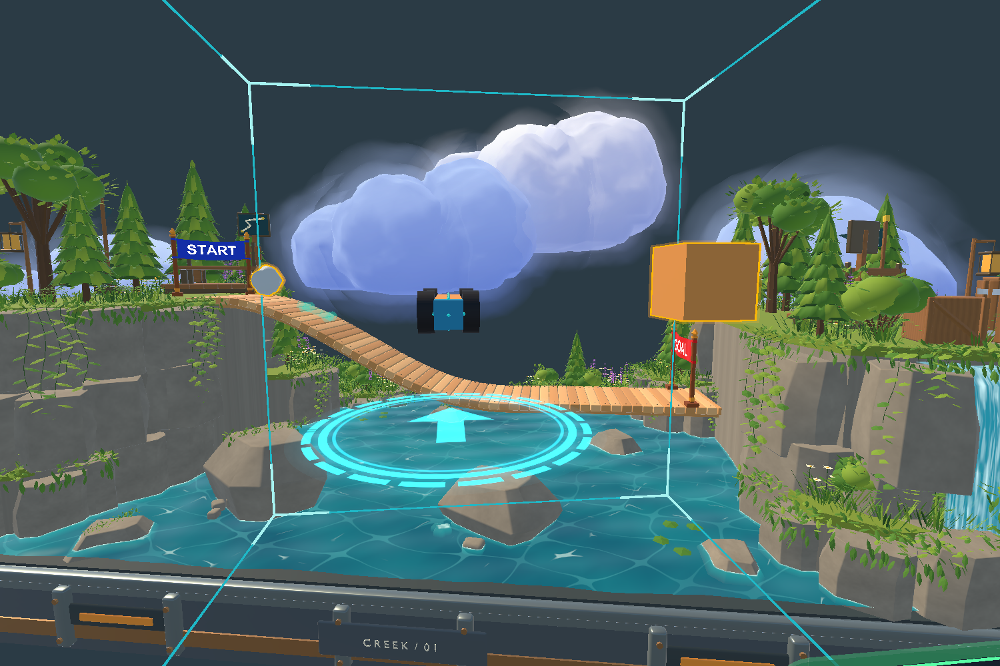
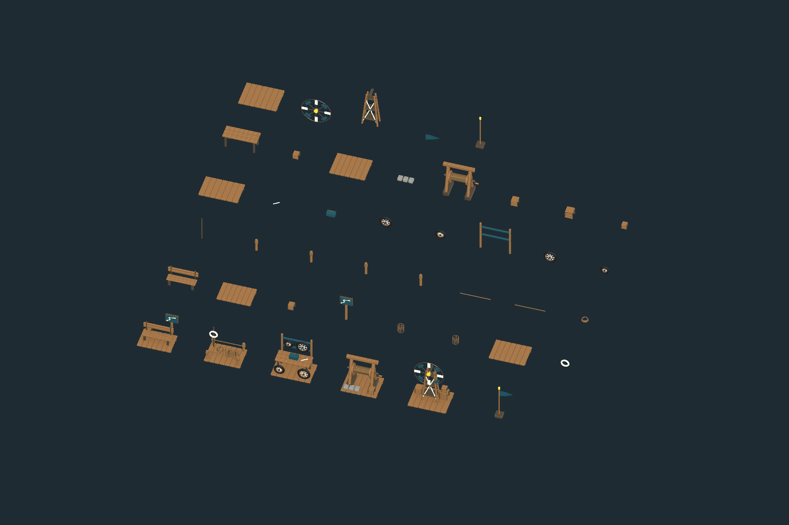
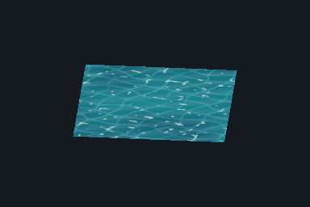
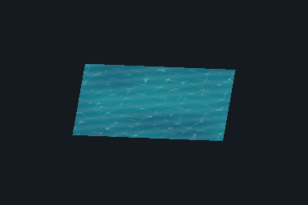

# 拼车场景：手工摆放素材与 shader 抗锯齿

适用于 `/main/car-scenery` 的五关拼车场景。所有效果均不依赖后处理。

## 植被 LOD 修复（2026-11-17）

当前五关的运行时植被 LOD 已重新生成。之前的目录引用旧 Botanical/Dressing 网格，未匹配到美术修整后 EnvironmentPolish 中的草地和树冠批次。现在在进入 Play Mode 和打包前检查已保存关卡 Prefab、植物 Prefab 及其网格/材质依赖的哈希；内容变化时重建目录。编辑场景后先保存，确保正常的 Save to Game 流程已经更新关卡 Prefab。也可手动执行 `MetaHackthone > Creek Art > Rebuild foliage and base anti-aliasing LODs`。

本次保留原始近景模型和现有合批方式。低精度花心从每朵 84 面改为 12 面；花瓣和叶片的六边形外缘保留，将中心六三角扇改为四三角形。树冠保留大体积及少量亮色针叶。已有粗几何树冠和树干不强行减面。生成网格保留 UV3/UV4 风动锚点、频率和相位，以及原网格的保守裁剪包围盒，避免切换后植物静止。碰撞体不参与替换。

以下仅统计此次匹配的植被 Renderer，一份几何、未计双眼或额外 Pass；低精度列表示这些对象都进入 LOD1，不是头显帧计数：

| 关卡 | 原始植被面数 | LOD1 植被面数 | 减少 |
| --- | ---: | ---: | ---: |
| 1 | 379,550 | 176,126 | 203,424 |
| 2 | 381,134 | 176,862 | 204,272 |
| 3 | 392,586 | 181,142 | 211,444 |
| 4 | 381,844 | 177,294 | 204,550 |
| 5 | 49,674 | 23,384 | 26,290 |

第一关的黄色花心单项从 45,276 面降为 6,468 面，减少 38,808 面；近看仍恢复原始细节。前四关各有六个草地材质批次、三个细叶树冠批次被运行时 LOD 覆盖。第五关的野花批次和独立植物也已覆盖。

验证：7/7 EditMode 检查通过（`bf3f7435541c428b814804dcc932958a`），覆盖当前网格引用、花心数量/范围、花瓣轮廓、风动数据及目录依赖；五关 PlayMode 检查通过（`97fad58f083d4ad18eca860c0c0f344f`），验证实际加载、近景自动恢复、禁用后还原，以及碰撞体、碰撞网格和位姿不变。五关同帧对照和近景截图已经检查。记录位于 `Logs/LODRepair-20261117/Reduction.json`、`Captures/Validation.txt` 及同目录 PNG。

### Quest 3 真机复测（2026-11-17，本地日期）

已构建并安装 `Builds/MetaHackthone-LODPerf.apk`（独立包名 `com.metahackathon2026.metahackthone.environmentperf`，版本 `0.1.0-lod1`）。用户手动完成五关测试并按 FINISH TEST，记录以 DONE 正常结束，总时长约 411 秒。可随版本控制同步的原始数据、汇总和对比位于 [Performance/20261117-LOD](Performance/20261117-LOD/)：`Before/` 为基线，`After/` 为本轮，附统计脚本、静态面数统计及测试 APK 校验信息。`Logs/` 中保留本机原始副本。

共享项目默认保持正常游戏配置：产品名 `MetaHackthone`、Android 包名 `com.metahackathon2026.metahackthone`、版本 `0.1.0`，首场景为 `MainMenu.unity`；没有激活性能测试 Build Profile。编辑器 Development 开关已恢复为关闭。现有 `MetaHackthone > Build Quest APK` 菜单仍按原有开发包流程输出 `Builds/MetaHackthone.apk`，不使用测试包名称或测试入口。性能采集脚本只在 Editor / Development 编译，并且 Android 仅在显式传入 `metahackthone.environment_perf=true` 时启动。APK 与 Unity 缓存遵循仓库忽略规则，不作为默认构建产物提交。

美术同步本次 `/main` 修改时应一并更新五关 Scene、Generated/Campaign Prefab、CreekDiorama 的网格和材质、`SceneryDetailCatalog`、LOD 编辑器/运行时代码及各自 `.meta`。这些均随项目提交；不要只复制场景文件。之后编辑并保存关卡，完成 Save to Game 后，进入 Play Mode 或打包会按当前素材重新检查并生成 LOD。

两次有效样本的眼缓冲均为 2496×2208、eyeScale 1.2545、viewport 1.0、90 Hz、ASW 关闭。沿用相同统计脚本，排除加载、每次 READY 后 8 秒预热、失去焦点和未佩戴样本。FPS 按总帧数 / 总时长统计，三角面数按帧加权。以下是运行时渲染计数，不等同于上面的单份资产几何统计。

| 关卡 | 观察 FPS：之前 → 之后 | 观察平均三角面：之前 → 之后 | 行驶 FPS：之前 → 之后 | 行驶平均三角面：之前 → 之后 |
| --- | ---: | ---: | ---: | ---: |
| 1 | 74.00 → 88.73 | 612,168 → 420,753 | 66.90 → 88.43 | 589,578 → 378,512 |
| 2 | 65.89 → 84.35 | 645,822 → 435,946 | 64.59 → 88.35 | 606,698 → 390,978 |
| 3 | 66.10 → 86.27 | 677,724 → 458,538 | 60.54 → 79.86 | 665,804 → 447,322 |
| 4 | 65.97 → 82.46 | 668,313 → 453,772 | 59.86 → 82.61 | 653,969 → 442,050 |
| 5 | 无有效基线 → 89.03 | 无有效基线 → 252,007 | 77.54 → 80.00 | 219,385 → 235,326 |

前四关观察阶段平均三角面减少 31.3%–32.5%，行驶阶段减少 32.4%–35.8%；行驶平均 FPS 提升 31.9%–38.0%。第三、四关行驶 GPU utilization 原始比例分别为 0.959、0.960，仍接近满载，尚未稳定达到 90 FPS。第五关行驶改善仅约 3.2%，本轮渲染面数反而更高；手动视角、可见内容和 LOD 切换并未固定，不能将这一差异解读为源模型增面或减面失效，也不能将全部帧率变化严格归因于 LOD。

有效观察时长（之前 / 之后，秒）：第一关 53.0 / 26.3，第二关 73.5 / 58.9，第三关 7.4 / 54.3，第四关 8.1 / 28.9，第五关无基线 / 11.2。有效行驶时长依次为 4.2 / 5.6、4.6 / 4.2、5.5 / 5.7、3.5 / 11.1、5.4 / 5.3 秒。行驶片段较短，这些结果属于一次手动复测，不能代表所有视角或长时间运行的稳定性。

当前主植被只有 LOD0 / LOD1，尚未增加更远距离的 LOD2 或小植物距离裁剪。下一步减面重点可放在远景植被；本轮没有改动水材质，不能用整帧 GPU 利用率推断水或瀑布各自的成本。原始 GPU / CPU 耗时字段保留 native API 单位，未据此报告经过验证的 GPU 毫秒数；Main Thread 时间包含等待，不当作纯 CPU 工作耗时。

## 合并程序 cs167（2026-11-12）

保留程序最新的五关操作区、玩家起点、环境与赛道摆放，在此基础上重新放置我们的道具并检查道路净空。场景和运行时 Prefab 同步，37 个手工零件及六套可展开组合保留。

Mobile 使用程序实测后的固定 1.0x 眼缓冲、2× MSAA，关闭动态分辨率、Depth Texture 和 Opaque Texture。三种河水材质（包括此前遗漏的第五关 Freight river）现在均不读取相机深度或场景颜色；保留程序水波与颜色动画。按真实水深变化的岸边泡沫和场景折射需要额外输入，当前默认不启用。两个采样开关已经独立，生成和预览工具也不会自动重新打开深度图。

同事在 cs167 中记录的单一静置头显视角测量显示，深度纹理约增加 5 ms；其较早 A/B 记录也未将边界盒定位为主要瓶颈。下面的透明覆盖分析仅说明旧盒子的潜在成本，不代表已经证明它导致 40→90 FPS 的差异。轻量边框继续保留，本次按用户要求暂不测真机。

合并检查：56/56 EditMode 通过，覆盖最新布局、五关净空、场景/Prefab 装饰位姿一致、水面开关、shader 与拆分素材。原场景美术的三角形道路侵入检查为空。实际加载测试结果及新截图见 [五关交付说明](Car-Campaign-Scenery.md)。

## 道路净空与轻量操作范围框

后续修正了八组贴近道路的装饰，其中第五关三个货运平台连同风车、岩柱和植物一起移位。道路宽度按真实样条逐段采样，预留两侧余量和道路上方三单位的车辆空间；风车和旗面的运动使用保守包围范围。五关场景及运行时关卡 Prefab 同步，原有赛道、碰撞体、机关和玩家位置不变。原有场景的有效网格也做了三角形与行车空间的相交检查，未发现额外侵入。

`MetaHackthone > Creek Art > Clear scenery from all campaign roads` 可以重新校验、移动新增装饰。`Apply car campaign scenery` 的生成过程也会调用同一检查，防止重新生成后又挡住道路。自定义手工摆放的其他对象仍应自行检查净空。

旧范围盒子的主要风险是填充与透明叠绘：`CreekAssemblyBounds.shader` 在完整盒面上执行边线、网格、光晕与扫描纹计算，使用 `Cull Off`、`ZWrite Off` 和透明混合。低透明度不会跳过片元计算；靠近玩家的大面积盒面在双眼高分辨率下仍需处理。旧方案不是因为“只画一个盒子，只有几个 draw call”就便宜，也不是靠关闭贴图 mipmap 能解决的问题。其 shader 本身没有纹理采样或折射抓屏。参见 [Unity 的 GPU 填充率与 overdraw 说明](https://unity.com/how-to/gpu-optimization)。

新资源保留同一个 BuildingArea 和 Artwork 根节点，改用 `Creek Diorama/Lightweight Range Frame`：

- 只提交十二条细边及加粗角标的几何，没有大面透明玻璃、整面桌面网格或重复霓虹壳。
- 不透明 Unlit、背面剔除、写深度；片元只输出顶点插值颜色，没有贴图、三角函数、周期网格、透明混合或后处理。
- 线条默认宽约 2.4 毫米，角标约 3.6 毫米；非均匀缩放范围时仍按世界宽度绘制。
- 保留 `SandboxBuildVolume.ShowWalls` 字段兼容场景。现在它控制轻量上边框：拼装时显示，开跑后隐藏；下方细周界保留。范围尺寸、越界判定和零件回收逻辑不变。
- `SetVisible` 仅在显示状态、开关或 Artwork 改变时更新 Renderer，避免逐帧重复写相同状态。

| 同一摄影机的独立资产对照 | 旧透明盒子 | 新细边框 |
| --- | ---: | ---: |
| Renderer | 3 | 2 |
| 三角形 | 9,280 | 432 |
| 1200×800 黑底图中的非黑像素 | 344,607 | 13,898 |

非黑像素是可见覆盖面积指标，不是精确片元调用次数或 GPU 耗时，不能据此换算帧率。旧盒子的背面/叠层也会额外执行 shader。

验证：13 项 EditMode 检查与两项 PlayMode 检查通过，覆盖五关净空、范围显示/隐藏/调整尺寸、材质结构以及五关实际运行。第四关细节近景见 [Level4-Art-Closeup.png](Level4-Art-Closeup.png)。

Quest 对照工具：`PhysicalAssembly.Editor.BoundaryReviewBuild.Build` 在 Android 目标上生成独立包名 `com.metahackathon2026.boundaryreview` 的开发 APK，不替换正式游戏。冷启动 intent `metahackthone.boundary_review=true` 后进入拼车场景，交替采集旧盒子、轻量边框和关闭范围三种状态，各稳定三秒、采样五秒，以交错顺序复测。日志前缀 `BOUNDARY_REVIEW` 同时记录帧率、CPU/GPU 返回指标、动态分辨率和头部漂移。旧资产只为此构建临时生成，构建结束删除；默认游戏不会启动诊断。

本次 Android 构建成功，独立测试包已安装到连接的 Quest 3。设备停在 `com.oculus.os.vrlockscreen`，应用未能进入运行状态，没有取得有效 FPS/GPU 对照数据。已停止测试应用、恢复正常佩戴传感器；正式游戏安装未替换。需要在头显内解锁后继续测量，不能把同事描述的 40→90 FPS 当成本次已复现的结果。现有 `QuestRenderAB` 的 `boundary_all_off` 也已纳入新 shader。

## mipmap 和各向异性过滤检查

| 项目 | 检查结果与处理 |
| --- | --- |
| 木纹、石灰岩、云的 2D 贴图 | 原来已开启 mipmap、Trilinear、8× anisotropic filtering，保留 |
| PC / Mobile Quality | 原来均为 Anisotropic Filtering = Enabled，保留 |
| PC / Mobile URP Asset | PC 保留 4×；Mobile 随程序 cs167 改为 2× MSAA。Quality 的旧 `antiAliasing: 0` 不是 URP 的实际 MSAA 设置 |
| `Textures/Clouds/CloudVolumeNoise.asset` | 原来只有一级，现生成完整 7 级 mip 链并使用 Trilinear；保留原 GUID |
| 程序生成的水波、细线、网格 | 不使用普通纹理采样，开启贴图 mipmap 不能解决，改用屏幕空间导数过滤 |

云的片元噪声采样现在可选用 mip 层；顶点变形仍显式取第 0 层，维持既有云形运动。

## shader 改动

`Assets/CreekDiorama/Shaders/CreekAnalyticAA.hlsl` 提供通用过滤函数。导数在 `abs`、`frac` 和阈值裁剪之前计算；亚像素线条按覆盖率降低亮度，避免只把细线加粗。不可分辨的程序噪声、周期波形收敛到均值，减少远处的高频变化。

- 水面：过滤焦散、泡沫、细碎闪光和法线波纹；高光随法线屏幕变化适当展宽并补偿强度。
- 瀑布和落水涟漪：过滤丝状亮纹、破碎噪声、细环和边界。瀑布亮纹在当前片元内进行 2×2 算术采样，没有增加纹理读取或渲染 pass。
- 方向盘徽记、拼装区线框：环、箭头、虚线和网格使用覆盖率过滤。
- 传送门、喷雾和云：软化遮罩/明暗过渡；合并后传送门沿用程序的 Opaque、ZWrite 和 AlphaToMask 覆盖率，并保留我们的内部纹理过滤。

[`fwidth`](https://learn.microsoft.com/en-us/windows/win32/direct3dhlsl/dx-graphics-hlsl-fwidth) 适用于片元 shader，不能消除所有几何轮廓锯齿。网格轮廓由平台配置的 MSAA 处理（Mobile 2×，PC 4×）。头显上的 GPU 开销和移动观看效果仍需实机检查。

## 程序手工摆场景

在 Project 中打开 `Assets/CreekDiorama/Prefabs/`，直接拖入场景：

| 目录 / 资产 | 用法 |
| --- | --- |
| `CarScenery/Parts/` | 新拆出的 37 个独立零件：长椅、路线图、木箱、码头、系泊柱、蟹笼、绳圈、救生圈、工具、轮架、车轮、绞盘、风车塔架/转子、旗杆/旗面等 |
| `CarScenery/Editable/*_Editable.prefab` | 六套完整道具由独立零件嵌套组成，展开即可单独移动、旋转、缩放或隐藏子零件 |
| `CarScenery/Editable/Creek_Environment_Editable.prefab` | 可编辑溪谷底景；树、石、花草与装饰使用独立实例，去掉合批副本，避免重复显示 |
| `CarScenery/Clouds/` | 三个独立远、中、近景云 Prefab，带既有云身、雾壳材质和动态效果 |
| `CarScenery/Transitions/` | 新增五种草花/补给/碎石组合；普通版合批，`Editable` 版可展开手摆。背景衔接说明见 [五关美术](Car-Campaign-Scenery.md) |
| `Botanical/` | 原有 18 个树木、蕨类、花草、石块等独立 Prefab |
| `Modules/` | 原有 20 个地形、桥和溪流等模块 |

静态新零件统一 Y 向上、缩放为 1，轴心放在实际网格底部中央，便于吸附地面。风车转子轴心位于转轴，旗面位于铰接点；保留 `CarSceneryBreeze` 动画组件，可禁用组件固定姿态。新拆分道具不包含 Collider 或 Rigidbody，需要交互时由程序另外添加。

完整溪谷中的植物位于 `10 Botanical dressing/Editable trees rocks plants and props`。建议复制整套 Prefab 的实例或创建 Prefab Variant 后调整布局。拆分增加了可独立编辑的 Renderer 数量；现有五关继续使用原先的合批资产，手工编辑版供搭景使用。

Unity 菜单 `MetaHackthone > Creek Art > Open manual scenery gallery` 打开零件陈列场景。也可以打开 `Assets/CreekDiorama/Scenes/CarSceneryPartsGallery.unity`。

作者工具 `Build manual scenery parts and gallery` 从 FBX 重建这些零件，校验拆分前后三角形数和完整组装边界一致。重建会覆盖自动生成的 Parts、Editable、Clouds 及陈列场景；自定义修改请保存在自己的实例或 Variant 中。旧的 `Apply car campaign scenery` 会替换关卡内 `Car campaign scenery` 分组，手工摆放后不要直接执行该命令。

详细零件数量和三角形对账见 [Scenery-Parts-Inventory.md](Scenery-Parts-Inventory.md)。原始 Blender 和 FBX 保留，五关布局及玩法组件不因本次拆分而改变。

## 无后处理对照（cs164 历史基线）

固定时间和摄影机，禁用后处理与 MSAA，以 384×256 渲染对比同一 shader 的 1536×1024 渲染按 4×4 像素平均后的参考。以下 RGB RMSE 用于检查分辨率变化的一致性，不等于实机闪烁或性能测试。

| 材质 | 修改前 RMSE | 修改后 RMSE |
| --- | ---: | ---: |
| 水面 | 0.020200 | 0.008635 |
| 瀑布 | 0.005791 | 0.005672 |
| 落水涟漪 | 0.041843 | 0.012967 |
| 传送门 | 0.016923 | 0.014567 |
| 方向盘徽记 | 0.022370 | 0.014033 |

水面示例（修改前 / 修改后）：

诊断入口为 `PhysicalAssembly.Editor.CreekShaderReview.After`，截图和 CSV 输出到 `Logs/CreekAA/`；`Before` 需在旧版 shader 上运行，当前调用不会自动切回旧版本。

## 拆分交付时的自动验证（cs164 历史记录）

- Unity 6000.3.21f1 桌面 EditMode：26/26 通过，覆盖九个修改后 shader、全部独立零件的轴心/材质/无碰撞体、六套嵌套组合、完整溪谷的独立植物，以及云 mipmap 和已有贴图/云设置。
- PlayMode：2/2 通过，实际加载五个拼车关卡，检查景物存在、动态部件运动和禁用后的姿态恢复。
- 拆分前后三角形总数逐组一致，组合后的边界一致；没有重新摆放五关或更新玩法组件。
- 本次验证没有运行 Quest/PICO 真机，不能据此断言移动 GPU 开销或所有几何边缘锯齿已解决。
